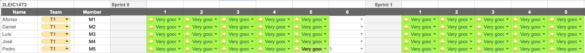

# Cents - Relatório de Desenvolvimento

Bem-vindo à documentação do Cents!

Encontras aqui os detalhes sobre o Cents, desde uma visão de alto nível até às decisões de implementação de baixo nível, num relatório de desenvolvimento de software organizado por tipo de atividade:

- [Como Correr a Aplicação](#como-correr-a-aplicação)
- [Modelação de Negócio](#modelação-de-negócio)
  - [Visão do Produto](#visão-do-produto)
  - [Funcionalidades e Pressupostos](#funcionalidades-e-pressupostos)
- [Requisitos](#requisitos)
  - [User Stories](#user-stories)
  - [Modelo de Domínio](#modelo-de-domínio)
- [Arquitetura e Design](#arquitetura-e-design)
  - [Arquitetura Lógica](#arquitetura-lógica)
  - [Arquitetura Física](#arquitetura-física)
  - [Protótipo Vertical](#protótipo-vertical)
- [Gestão do Projeto](#gestão-do-projeto)
  - [Sprint 0](#sprint-0)
  - [Sprint 1](#sprint-1)
  - [Sprint 2](#sprint-2)
  - [Sprint 3](#sprint-3)
  - [Entrega Final](#entrega-final)

As contribuições são esperadas exclusivamente pela equipa inicial, mas poderemos abri-las à comunidade após o curso, em todas as áreas e tópicos: requisitos, tecnologias, desenvolvimento, experimentação, testes, etc...

Entre em contacto connosco!

Obrigado!

---

## Membros da Equipa

| Nome | Email |
| ---- | ----- |
|      |       |

---

## Como Correr a Aplicação

### Pré-requisitos

- [Node.js](https://nodejs.org/) (versão LTS recomendada)
- [Expo Go](https://expo.dev/go) instalado no dispositivo móvel (iOS ou Android)

### Instalação

```bash
# Clonar o repositório
git clone <url-do-repositório>
cd <pasta-do-projeto>

# Instalar dependências
npm install
```

### Execução

```bash
# Iniciar em modo Expo Go
npx expo start --go

# Limpar cache (caso necessário, recomendado em caso de erros inesperados)
npx expo start --go -c
```

Após iniciar, abre a aplicação **Expo Go** no teu dispositivo e lê o QR code exibido no terminal.

---

## Modelação de Negócio

### Visão do Produto

O Cheapy surgiu da necessidade do consumidor final saber onde a sua lista de compras é mais barata, cruzando os preços de vários supermercados com as promoções existentes.

Dado um conjunto de produtos selecionados pelo utilizador, a aplicação analisa os preços nos principais supermercados portugueses e sugere a melhor combinação de lojas para que as compras sejam o mais baratas possível, tendo em conta fatores como a distância ao supermercado.

Para além da comparação de preços, a aplicação permite ao utilizador criar e gerir as suas listas de compras, tornando o processo mais rápido e organizado. As listas podem ser partilhadas com outras pessoas e guardadas nos favoritos, o que facilita a reutilização em compras frequentes e torna a experiência mais prática no dia a dia.

### Funcionalidades e Pressupostos

**Funcionalidades**

- **Autenticação** - Registo e login de utilizadores, com proteção de rotas e gestão de sessão.
- **Pesquisa de Supermercados** - Pesquisa de supermercados por nome, com filtragem por distância e estado de funcionamento (aberto/fechado).
- **Geolocalização** - Cálculo da distância entre o utilizador e os supermercados disponíveis, usando a fórmula de Haversine.
- **Horários** - Consulta do horário de funcionamento de cada supermercado.
- **Pesquisa de Produtos** - Pesquisa e adição de produtos ao carrinho de compras.
- **Comparação de Preços** - Dado um carrinho de produtos, a aplicação identifica o supermercado onde o total é mais baixo, considerando as promoções disponíveis.
- **Otimização Multi-loja** - Sugestão da melhor combinação de supermercados para minimizar o custo total do carrinho.
- **Listas de Compras** - Criação, edição e reutilização de listas de compras personalizadas.
- **Carrinho Partilhado** - Partilha de listas de compras com outros utilizadores.
- **Favoritos** - Possibilidade de guardar listas nos favoritos para reutilização futura.
- **Perfil** - Página pessoal com informações do utilizador e histórico de compras.
- **Recomendações** - Sugestão de produtos com base no histórico de compras do utilizador.
- **Indicador Ecológico** - Identificação de produtos com baixa pegada de carbono.
- **Indicador Nutricional** - Classificação da qualidade nutricional de cada produto.
- **Modo Offline** - Acesso ao carrinho de compras sem necessidade de ligação à internet.
- **Definições** - Gestão de notificações e preferências do utilizador.

**Pressupostos**

- A aplicação depende do Firebase para os serviços de base de dados (Firestore) e autenticação (Auth).
- Os dados de produtos e preços são inseridos manualmente ou via API, não sendo garantida atualização automática.
- A geolocalização do utilizador é acedida via GPS do dispositivo, através da biblioteca `expo-location`.
- A aplicação assume que o utilizador tem ligação à internet para a maioria das funcionalidades, exceto o modo offline.

---

## Happiness Meters

<p align="center">
  
</p>

---

## Requisitos

### User Stories

As user stories foram criadas e geridas no [GitHub Projects](https://github.com/orgs/FEUP-LEIC-ES-2025-26/projects). Segue-se um resumo das histórias identificadas:

- Enquanto utilizador não registado, quero registar uma conta na aplicação, de modo a guardar toda a informação necessária.
- Enquanto utilizador registado, quero fazer login na aplicação, de modo a ter acesso a toda a minha informação.
- Enquanto utilizador registado, quero ver o meu perfil, para que possa saber se estou na minha conta.
- Enquanto utilizador, quero selecionar os supermercados onde a pesquisa vai ser feita, para escolher os meus preferidos.
- Enquanto utilizador, quero filtrar a lista de supermercados pela distância e verificar os que estão abertos, para decidir rapidamente onde fazer compras.
- Enquanto utilizador, quero consultar o horário de funcionamento dos supermercados, para planear as minhas compras de forma mais eficiente.
- Enquanto utilizador, quero ver se os produtos são ecológicos, para diminuir a minha pegada ambiental.
- Enquanto utilizador, quero consultar onde o meu carrinho de compras é mais barato, para que possa poupar dinheiro.
- Enquanto utilizador, quero esvaziar o carrinho, para que não tenha de remover manualmente cada produto.

### Modelo de Domínio

<p align="center">
  
</p>

O modelo de domínio é composto por 13 classes que representam os conceitos centrais do sistema. A entidade principal é o `UtilizadorRegistado`, que possui um `Carrinho` com `ItemCarrinho` e `Produtos`, uma lista de `Favoritos`, `CarrinhosFavoritos` e `HistoricoCarrinho`. Os `Supermercados` têm `Localizacao`, `Horarios` e praticam preços via `PrecoProduto`. O `UtilizadorAnonimo` pode usar o `Carrinho`, mas não tem acesso a funcionalidades exclusivas de utilizadores registados.

Para mais detalhes: [Modelo de Domínio PDF](docs/domain/domain_model.pdf)

---

## Arquitetura e Design

A arquitetura da aplicação segue uma organização em camadas, separando a interface do utilizador da lógica de negócio. A camada de apresentação é composta por ecrãs e componentes reutilizáveis, enquanto a lógica da aplicação é gerida por hooks e constantes partilhadas. Esta separação facilita a manutenção e evolução do código ao longo do projeto.

### Arquitetura Lógica

<p align="center">
  
</p>

A arquitetura lógica organiza o sistema em quatro camadas: Presentation (Navigation, Screens, Components), Logic (Hooks, Utils), Data (Firebase Config, Constants) e External Services (Firebase Firestore, expo-location, Firebase Auth). Os ecrãs utilizam os componentes e hooks, os hooks utilizam utils e acedem ao Firebase e ao GPS.

Para mais detalhes: [Diagrama de Pacotes PDF](docs/architecture/package_diagram.pdf)

### Arquitetura Física

<p align="center">
  
</p>

A aplicação corre num dispositivo móvel (iOS/Android) em React Native com Expo, comunicando com o Firebase Cloud (Firestore, Auth, Storage) via HTTPS/REST. O GPS é acedido nativamente via `expo-location` e os dados são persistidos localmente via `AsyncStorage`. A distribuição é feita através da App Store (iOS) e Google Play (Android).

Para mais detalhes: [Diagrama de Deployment PDF](docs/architecture/deployment_diagram.pdf)

### Protótipo Vertical

O protótipo vertical implementado no Sprint 0 foca-se na funcionalidade central de pesquisa e localização de supermercados. Esta _thin vertical slice_ prova a viabilidade das integrações nativas com React Native e Expo.

Através da integração com o GPS do dispositivo e a base de dados Firebase Firestore, o sistema consegue ler as coordenadas do utilizador, extrair as lojas ativas, calcular a distância usando a fórmula de Haversine e verificar se cada loja se encontra dentro do seu horário de funcionamento. Os resultados são apresentados numa lista pesquisável por nome.

**Screenshots**

<p align="center">
  
  &nbsp;&nbsp;&nbsp;
  
  &nbsp;&nbsp;&nbsp;
  
</p>

Nota: Nesta iteração, alguns botões e elementos interativos ainda não se encontram totalmente operacionais. Estes elementos fazem parte das funcionalidades planeadas para os sprints seguintes.

---

## Gestão do Projeto

A gestão do projeto é feita através do [GitHub Projects](https://github.com/orgs/FEUP-LEIC-ES-2025-26/projects), onde são registadas e acompanhadas todas as user stories, tarefas e o progresso de cada sprint.

**Definição de Pronto**

- A user story tem mockup associado.
- A user story foi estimada pela equipa.
- A user story tem acceptance tests definidos.
- A user story está no Sprint Backlog no board do projeto.

**Definição de Concluído**

- O pull request foi revisto e aprovado.
- Os acceptance tests e unit tests passaram.
- A funcionalidade foi testada num dispositivo móvel real.

---

### Sprint 0

#### Board do Projeto

Início do Sprint 0


Fim do Sprint 0


#### Funcionalidades Implementadas

- Pesquisa de supermercados por @dcl674
- Página de login por @JoseSantos56
- Página de registo por @JoseSantos56
- DependaBot e scripts de DevOps por @bcdtrak

#### Retrospetiva

**O que correu bem**

- Desenho do Protótipo: A equipa conseguiu implementar um protótipo funcional centrado na funcionalidade principal da app, demonstrando com sucesso o propósito do produto.

**O que fazer de forma diferente**

- Distribuição de Trabalho: A distribuição de tarefas foi desequilibrada, com alguns elementos a implementar significativamente mais do que outros. A equipa irá abordar este ponto no próximo sprint.

**Questões em aberto**

- Base de Dados de Produtos: É necessário definir uma estratégia para popular a base de dados de produtos, manualmente ou via API, de modo a que a funcionalidade de pesquisa de produtos funcione corretamente.

---

### Sprint 1

#### Board do Projeto

Início do Sprint 1


Fim do Sprint 1


#### Funcionalidades Implementadas

- Pesquisa de produtos por @dcl674
- Seleção de localização por @bcdtrak
- Filtros por distância e estado da loja (aberto/fechado) por @dcl674
- Página de perfil pessoal por @lluissampaio
- Página de login por @JoseSantos56
- Página de registo por @JoseSantos56

#### Retrospetiva

**O que correu bem**

- Implementação Paralela: A equipa implementou 3 funcionalidades em simultâneo e integrou-as sem grandes conflitos, progredindo em várias frentes ao mesmo tempo.
- Distribuição de Trabalho: A carga de trabalho foi distribuída de forma mais equilibrada, resultando num aumento de produtividade em comparação com o sprint anterior.

**O que fazer de forma diferente**

- Comunicação: A comunicação entre os elementos da equipa foi escassa, o que dificultou a implementação de algumas funcionalidades planeadas e reduziu a produtividade global. A equipa irá estabelecer check-ins mais regulares.

**Questões em aberto**

- Integração Carrinho-Base de Dados: É necessário definir como ligar o carrinho do utilizador à base de dados, de modo a obter os metadados necessários para os cálculos de preço.

---

### Sprint 2

#### Board do projeto

##### Antes


##### Depois


#### Funcionalidades Implementadas

- Página de produto por @dcl674
- Página de supermercado por @bcdtrack
- Dark/Light mode por @bcdtrack
- Carrinho por @lluissampaio
- Ecrã esquecer password por @JoseSantos56
- Ecrã inicial por @lluissampaio

#### Retrospetiva

**O que correu bem**

- Implementação Paralela: A equipa implementou 3 funcionalidades em simultâneo e integrou-as sem grandes conflitos, progredindo em várias frentes ao mesmo tempo.
- Distribuição de Trabalho: A carga de trabalho foi distribuída de forma mais equilibrada, resultando num aumento de produtividade em comparação com o sprint anterior.

**O que fazer de forma diferente**

- Comunicação: A comunicação entre os elementos da equipa foi escassa, o que dificultou a implementação de algumas funcionalidades planeadas e reduziu a produtividade global. A equipa irá estabelecer check-ins mais regulares.

**Questões em aberto**

- Como melhorar a segurança da app.

---

### Sprint 3

_A preencher no final do sprint._

---

### Entrega Final

_A preencher na entrega final._
