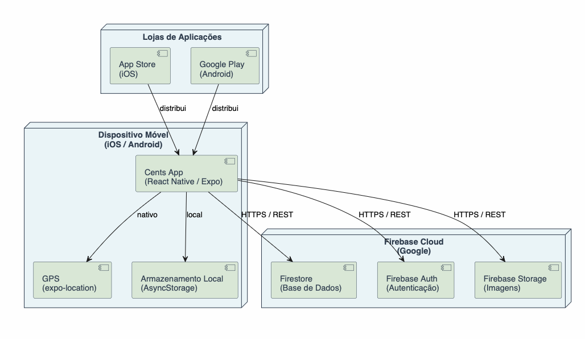

# Cents

Aplicação móvel de comparação de preços de supermercado, desenvolvida em React Native com Expo e Firebase. Permite ao utilizador gerir uma lista de compras otimizada por preço, pesquisar supermercados próximos e acompanhar as compras em tempo real através de uma checklist interativa.

---

## Índice

- [Como Correr a Aplicação](#como-correr-a-aplicação)
- [Modelação de Negócio](#modelação-de-negócio)
  - [Visão do Produto](#visão-do-produto)
  - [Funcionalidades e Pressupostos](#funcionalidades-e-pressupostos)
- [Requisitos](#requisitos)
  - [User Stories](#user-stories)
  - [Modelo de Domínio](#modelo-de-domínio)
- [Arquitetura e Design](#arquitetura-e-design)
  - [Arquitetura Lógica](#arquitetura-lógica)
  - [Arquitetura Física](#arquitetura-física)
  - [Protótipo Vertical](#protótipo-vertical)
- [Validação de Requisitos](#validação-de-requisitos)
- [Gestão do Projeto](#gestão-do-projeto)
  - [Sprint 0](#sprint-0)
  - [Sprint 1](#sprint-1)
  - [Sprint 2](#sprint-2)
  - [Sprint 3](#sprint-3)
  - [Entrega Final](#entrega-final)
  - [Validação Final da Aplicação](#validação-final-da-aplicação)
- [Equipa](#equipa)

As contribuições são esperadas exclusivamente pela equipa inicial, mas poderemos abri-las à comunidade após o curso, em todas as áreas e tópicos: requisitos, tecnologias, desenvolvimento, experimentação, testes, etc...

Entre em contacto connosco!

## Obrigado!

## Como Correr a Aplicação

### Pré-requisitos

- [Node.js](https://nodejs.org/) (versão LTS recomendada)
- [Expo Go](https://expo.dev/go) instalado no dispositivo móvel (iOS ou Android)

### Instalação

```bash
git clone <url-do-repositório>
cd <pasta-do-projeto>
npm install
```

### Execução

```bash
# Iniciar em modo Expo Go
npx expo start --go

# Limpar cache (recomendado em caso de erros inesperados)
npx expo start --go -c
```

Após iniciar, abrir a aplicação **Expo Go** no dispositivo e ler o QR code exibido no terminal.

### Build Local com EAS

1. Instalar o EAS CLI globalmente:

```bash
npm install -g eas-cli
```

2. Fazer login na conta Expo:

```bash
eas login
```

3. Executar o build localmente:

```bash
# Android (gera ficheiro .apk)
eas build --profile development --platform android --local

# iOS (requer macOS com Xcode; gera build para Simulador)
eas build --profile development --platform ios --local
```

> A compilação de builds locais requer o ambiente de desenvolvimento mobile respetivo (ex: Android Studio para Android).

---

## Modelação de Negócio

### Visão do Produto

O Cents é uma aplicação focada em simplificar, organizar e otimizar as compras de supermercado. O objetivo central é permitir que o utilizador pesquise produtos de forma intuitiva, os adicione a uma lista e identifique rapidamente as opções mais económicas.

A aplicação adapta-se ao perfil de consumo de cada utilizador: quem prefere a poupança máxima pode combinar produtos de várias lojas; quem prefere conveniência pode restringir os resultados a um único supermercado. A funcionalidade de checklist interativa apoia o utilizador durante a deslocação à loja, reduzindo esquecimentos e acelerando o processo de compra.

### Funcionalidades e Pressupostos

**Funcionalidades**

- **Pesquisa de Produtos por Categoria:** exploração e adição de produtos à lista de compras, organizados pelas respetivas categorias.
- **Otimização de Preços (Toggle Mix/Loja Única):** alternância entre o cálculo do melhor preço absoluto (combinando produtos de diferentes lojas) e a restrição a uma única loja.
- **Checklist Interativa de Compras:** modo de visualização orientado ao momento da compra, em que os produtos clicados ficam marcados, passam a cinzento e descem para o fim da lista.
- **Pesquisa de Supermercados e Horários:** localização de supermercados próximos com base no GPS do dispositivo ou numa localização introduzida manualmente (via API Photon), com apresentação dos horários de funcionamento.
- **Sistema de Utilizadores (Conta vs. Convidado):** acesso à aplicação como convidado ou através de conta registada, com funcionalidades adicionais para utilizadores autenticados.
- **Sincronização na Cloud:** sincronização automática e em tempo real da lista de compras com o Firestore, para utilizadores com conta registada.
- **Gestão de Conta Segura:** recuperação de palavra-passe e alteração de e-mail com verificação por mensagem de confirmação.
- **Personalização da Interface (Dark/Light Mode):** suporte para modo claro e modo escuro, adaptado às preferências do utilizador.

**Pressupostos**

- A aplicação utiliza o Firebase como infraestrutura principal para autenticação (Auth) e base de dados em tempo real (Firestore).
- Os produtos, supermercados e horários presentes no Firestore são dados simulados (mocks) para efeitos de prova de conceito.
- A pesquisa e conversão de localizações manuais dependem da API externa Photon.
- A ligação ativa à internet é necessária para sincronização na cloud, pesquisa de supermercados e operações de autenticação.

---

## Requisitos

### User Stories

As user stories foram criadas e geridas no [GitHub Projects](https://github.com/orgs/FEUP-LEIC-ES-2025-26/projects).

**Autenticação e Gestão de Conta**

- Enquanto utilizador, quero ser recebido por um ecrã inicial com opções claras para entrar com conta ou aceder como convidado.
- Enquanto utilizador não registado, quero criar uma conta na aplicação, de modo a guardar e sincronizar a minha lista de compras.
- Enquanto utilizador registado, quero fazer login na aplicação, de modo a aceder à minha informação guardada.
- Enquanto utilizador registado, quero ter acesso a uma aba de conta para visualizar o meu perfil (nome e foto genérica).
- Enquanto utilizador registado, quero conseguir recuperar a minha palavra-passe e alterar o meu e-mail de forma segura, para garantir o acesso e a segurança da minha conta.

**Supermercados e Localização**

- Enquanto utilizador, quero pesquisar supermercados perto de mim usando a minha localização atual ou uma localização que eu defina manualmente.
- Enquanto utilizador, quero filtrar a lista de supermercados pela distância e verificar se estão abertos.
- Enquanto utilizador, quero consultar o horário de funcionamento dos supermercados para planear as minhas compras.

**Produtos e Lista de Compras**

- Enquanto utilizador, quero pesquisar e explorar produtos organizados por categoria.
- Enquanto utilizador, quero adicionar produtos à minha lista de compras e gerir as suas quantidades num ecrã dedicado.
- Enquanto utilizador, quero visualizar os dados básicos do produto e comparar os seus preços em diferentes supermercados.
- Enquanto utilizador, quero escolher entre a opção de melhor preço absoluto (mix de supermercados) ou restringir os produtos a uma loja específica.
- Enquanto utilizador, quero uma checklist interativa dos produtos a comprar, em que os itens clicados ficam marcados, passam a cinzento e descem para o fundo da lista, para me organizar durante as compras.

**Personalização**

- Enquanto utilizador, quero escolher o tema da aplicação (modo claro ou escuro) para que a interface se ajuste às minhas preferências.

### Modelo de Domínio

<p align="center">
  
</p>

O modelo de domínio é composto por 13 classes que representam os conceitos centrais do sistema. A entidade principal é o `UtilizadorRegistado`, que possui um `Carrinho` com `ItemCarrinho` e `Produtos`, uma lista de `Favoritos`, `CarrinhosFavoritos` e `HistoricoCarrinho`. Os `Supermercados` têm `Localizacao`, `Horarios` e praticam preços via `PrecoProduto`. O `UtilizadorAnonimo` pode utilizar o `Carrinho`, sem acesso às funcionalidades exclusivas de utilizadores registados.

Para mais detalhes: [Modelo de Domínio PDF](docs/domain/domain_model.pdf)

---

## Arquitetura e Design

A arquitetura da aplicação segue uma organização em camadas, separando a interface do utilizador da lógica de negócio. A camada de apresentação é composta por ecrãs e componentes reutilizáveis; a lógica da aplicação é gerida por hooks e utilitários partilhados. Esta separação facilita a manutenção e evolução do código ao longo do projeto.

### Arquitetura Lógica

<p align="center">
  
</p>

A arquitetura lógica organiza o sistema em quatro camadas:

- **Presentation:** Navigation, Screens, Components
- **Logic:** Hooks, Utils
- **Data:** Firebase Config, Constants
- **External Services:** Firebase Firestore, expo-location, Firebase Auth

Os ecrãs utilizam os componentes e hooks; os hooks utilizam utilitários e acedem ao Firebase e ao GPS.

Para mais detalhes: [Diagrama de Pacotes PDF](docs/architecture/package_diagram.pdf)

### Arquitetura Física

<p align="center">
  
</p>

A aplicação corre num dispositivo móvel (iOS/Android) em React Native com Expo, comunicando com o Firebase Cloud (Firestore, Auth, Storage) via HTTPS/REST. O GPS é acedido nativamente via `expo-location` e os dados são persistidos localmente via `AsyncStorage`. A distribuição é feita através da App Store (iOS) e Google Play (Android).

Para mais detalhes: [Diagrama de Deployment PDF](docs/architecture/deployment_diagram.pdf)

### Protótipo Vertical

O protótipo vertical implementado no Sprint 0 foca-se na funcionalidade central de pesquisa e localização de supermercados, validando a viabilidade das integrações nativas com React Native e Expo.

Através da integração com o GPS do dispositivo e o Firestore, o sistema lê as coordenadas do utilizador, extrai as lojas ativas, calcula a distância via fórmula de Haversine e verifica se cada loja se encontra dentro do seu horário de funcionamento. Os resultados são apresentados numa lista pesquisável por nome.

**Screenshots**

<p align="center">
  
  &nbsp;&nbsp;&nbsp;
  
  &nbsp;&nbsp;&nbsp;
  
</p>

> Nesta iteração, alguns elementos interativos ainda não estavam totalmente operacionais. Estes fazem parte das funcionalidades implementadas nos sprints seguintes.

---

## Validação de Requisitos

No início do projeto foi realizado um questionário ao público-alvo (21 respostas) para validar a utilidade da aplicação e identificar as funcionalidades prioritárias. Este processo informou a composição do Product Backlog com base em dados quantitativos.

Formulário: [https://tally.so/r/pbWPjV](https://tally.so/r/pbWPjV)

### Resultados

<table>
  <tr>
    <td width="50%">
      
    </td>
    <td width="50%">
      
    </td>
  </tr>
</table>

### Principais Conclusões e Impacto no PBL

- **Priorização da Checklist:** 95,2% dos utilizadores considera importante planear as compras (38,1% faz sempre lista; 57,1% faz ocasionalmente). Este resultado levou à priorização da checklist interativa (Issue #117) como substituto do fluxo tradicional de lista em papel.
- **Implementação do Modo Convidado:** 95,2% dos inquiridos avaliou a ideia principal com nota igual ou superior a 4 em 5. Para reduzir o atrito no primeiro acesso e preservar esta base de utilizadores, eliminou-se a obrigatoriedade de registo, adotando um modo convidado assíncrono via Firebase.
- **Toggle de Poupança vs. Conveniência:** 47,6% dos inquiridos procura ativamente o supermercado com melhores promoções e 28,6% desloca-se a várias lojas na mesma semana, enquanto 23,8% prioriza a conveniência de uma loja única. Esta distribuição validou o desenvolvimento do algoritmo de otimização bifuncional no carrinho.
- **Corte de Funcionalidades:** a partilha de listas obteve a classificação mais baixa no ranking de prioridades (média de 5,0, último lugar isolado). Dado o rácio de rejeição ou indiferença acentuado, a funcionalidade foi removida do backlog operacional para garantir a entrega atempada dos componentes críticos.

---

## Gestão do Projeto

A gestão do projeto é feita através do [GitHub Projects](https://github.com/orgs/FEUP-LEIC-ES-2025-26/projects), onde são registadas e acompanhadas todas as user stories, tarefas e o progresso de cada sprint.

**Definição de Pronto**

- A user story tem mockup associado.
- A user story foi estimada pela equipa.
- A user story tem acceptance tests definidos.
- A user story está no Sprint Backlog no board do projeto.

**Definição de Concluído**

- O pull request foi revisto e aprovado.
- Os acceptance tests e unit tests passaram.
- A funcionalidade foi testada num dispositivo móvel real.

---

### Sprint 0

#### Board do Projeto

Início do Sprint 0


Fim do Sprint 0


#### Funcionalidades Implementadas

- Pesquisa de supermercados por @dcl674: página de pesquisa para supemercados, mostrando nome e o estado do supermercado
- Página de login por @JoseSantos56: página de login completa conectada ao Firebase Auth
- Página de registo por @JoseSantos56: página de registo completa conectada ao Firebase Auth
- DependaBot e scripts de DevOps por @bcdtrak

#### Retrospetiva

**O que correu bem**

- Desenho do Protótipo: a equipa implementou um protótipo funcional centrado na funcionalidade principal da aplicação, demonstrando o propósito do produto.

**O que fazer de forma diferente**

- Distribuição de Trabalho: a distribuição de tarefas foi desequilibrada, com alguns elementos a implementar significativamente mais do que outros. Este ponto foi endereçado no sprint seguinte.

**Questões em aberto**

- Estratégia para popular a base de dados de produtos (manualmente ou via API), necessária para o correto funcionamento da funcionalidade de pesquisa.

---

### Sprint 1

#### Board do Projeto

Início do Sprint 1


Fim do Sprint 1


#### Funcionalidades Implementadas

- Pesquisa de produtos por @dcl674
- Seleção de localização por @bcdtrak
- Filtros por distância e estado da loja (aberto/fechado) por @dcl674
- Página de perfil pessoal por @lluissampaio
- Página de login por @JoseSantos56
- Página de registo por @JoseSantos56

#### Retrospetiva

**O que correu bem**

- Implementação Paralela: foram implementadas três funcionalidades em simultâneo e integradas sem conflitos significativos.
- Distribuição de Trabalho: a carga de trabalho foi distribuída de forma mais equilibrada relativamente ao sprint anterior.

**O que fazer de forma diferente**

- Comunicação: a comunicação entre os elementos da equipa foi escassa, dificultando a implementação de algumas funcionalidades planeadas. Foram estabelecidos check-ins mais regulares para o sprint seguinte.

**Questões em aberto**

- Definição da estratégia de ligação entre o carrinho do utilizador e a base de dados, para acesso aos metadados necessários nos cálculos de preço.

---

### Sprint 2

#### Board do Projeto

Antes


Depois


#### Funcionalidades Implementadas

- **Ecrã Inicial** por @lluissampaio: landing page com opções de login, registo e entrada como convidado.
- **Página de Produtos** por @dcl674: visualização de preços em vários supermercados, com dados adicionais (Nutriscore, Ecoscore, quantidade) e adição ao carrinho.
- **Página de Horários de Supermercados** por @bcdtrak: consulta do horário completo do supermercado selecionado.
- **Carrinho de Compras** por @lluissampaio: gestão da lista de compras com toggle entre melhor preço absoluto (mix de supermercados) e restrição a uma loja única; integração com Firestore.
- **Recuperação e Gestão de Conta** por @JoseSantos56: ecrã de recuperação de palavra-passe e lógica de verificação por e-mail na alteração de dados do utilizador.
- **Dark/Light Mode** por @bcdtrak: suporte para alternância entre modo claro e escuro em toda a aplicação.

#### Retrospetiva

**O que correu bem**

- Implementação Paralela: seis funcionalidades implementadas em simultâneo e integradas sem conflitos relevantes.
- Distribuição de Trabalho: carga de trabalho distribuída de forma equilibrada, com aumento de produtividade face ao sprint anterior.

**O que fazer de forma diferente**

- Organização: a equipa poderia ter planeado melhor a calendarização das tarefas para concluir as funcionalidades mais cedo no período do sprint.

**Questões em aberto**

- Estratégia para reforço da segurança da aplicação.

#### Ferramentas de IA Utilizadas

Gemini, GLM, Claude, Deepseek.

#### Prompts Relevantes

1. Como resolver as dependências do projeto?
2. A aplicação não está a abrir no Expo Go; como resolver?
3. O workflow do GitHub Actions não está a fazer upload dos build artifacts; como corrigir?
4. Como funciona o Zustand? Explicação da instalação e sintaxe específica.
5. O que fazer para sincronizar o Firestore com `users/{uid}/cart/default` através de um hook?

#### Código Gerado por IA

- `package.json`
- `firebaseConfig.js`
- Parte de `/store/useCartStore.js`

> A IA foi utilizada como assistente de implementação e depuração. Nenhum PBI foi integralmente gerado por IA.

---

### Sprint 3

#### Board do Projeto

Antes


Depois


#### Funcionalidades Implementadas

- **Pesquisa de Produto por Categoria** por @dcl674: filtragem de produtos por categoria para otimizar o processo de seleção.
- **Edição do Perfil** por @lluissampaio: personalização dos dados da conta do utilizador.
- **Gestão de Conta** por @lluissampaio: secção para alteração de informações de segurança e manutenção da conta.
- **Página de Ajuda** por @lluissampaio: página de orientação ao utilizador sobre o uso da aplicação.
- **Checklist Interativa** por @bcdtrak: modo de uso na loja em que os produtos clicados ficam marcados, passam a cinzento e descem para o fim da lista.
- **Página "Sobre Nós"** por @noloseiiird: créditos aos autores da aplicação.
- **Botão de Limpeza de Texto** por @noloseiiird: atalho nas barras de pesquisa para apagar rapidamente o texto inserido.
- **Destaque de Promoções** por @JoseSantos56: exibição dos produtos com melhor preço por supermercado, mostrando preço atual e preço original para comparação.
- **Produtos Ecológicos** por @JoseSantos56: secção dedicada a produtos sustentáveis com indicador visual (ícone/verde) para fácil identificação.

#### Retrospetiva

**O que correu bem**

- Implementação Paralela: sete funcionalidades implementadas e integradas em simultâneo sem conflitos.
- Organização: a equipa utilizou as frameworks de gestão disponíveis de forma mais eficaz, acelerando a integração das funcionalidades.

**O que fazer de forma diferente**

- Delegação de Tarefas: a distribuição de trabalho foi ligeiramente desequilibrada, o que condicionou o ritmo de desenvolvimento de novas funcionalidades.
- Comunicação: apesar da melhoria face ao início do projeto, a comunicação revelou-se pontualmente insuficiente, gerando repetição desnecessária de tarefas.

**Questões em aberto**

- Estruturação da demo e preparação do pitch final.

#### Ferramentas de IA Utilizadas

Gemini, GLM, Claude, Deepseek.

#### Prompts Relevantes

- "O Detox está a demorar muito tempo a completar os testes; podes analisar o ficheiro de configuração e propor alterações para melhorar o desempenho?"
- "Estou com um erro de build no Detox; podes ajudar a identificar a causa?"

#### Código Gerado por IA

- `.detoxrc.js`

> A IA foi utilizada como assistente de implementação e depuração. Nenhum PBI foi integralmente gerado por IA.

---

#### Validação Final da Aplicação

Na fase final do projeto, foi realizado um questionário focado na interface e usabilidade (com a participação de 5 respondentes) para validar o resultado final da aplicação, a clareza das funcionalidades desenvolvidas e a intenção de adoção por parte dos utilizadores. Este processo foi fundamental para confirmar se as necessidades identificadas no início do projeto foram resolvidas de forma eficaz na versão final.

Formulário: [https://tally.so/r/68MNXJ](https://tally.so/r/68MNXJ)

### Resultados

<table>
  <tr>
    <td width="50%">
      
    </td>
    <td width="50%">
      
    </td>
  </tr>
</table>

**Principais Conclusões e Feedback Final:**

  Aprovação do Design e Onboarding: 80% dos utilizadores (4 em 5) consideram que o design inicial é polido, moderno e transmite confiança, com os restantes 20% a referir que tem bom aspeto. A implementação da entrada rápida como "Convidado" lado a lado com a criação de conta obteve uma taxa de aprovação absoluta, com 100% dos inquiridos a avaliar a intuição e utilidade desta abordagem com a pontuação máxima de 5 estrelas.

  Sucesso da Otimização do Carrinho: O Toggle de "Melhor Preço" vs. "Loja Única" consolidou-se como o elemento central da aplicação, sendo considerado por 100% dos respondentes como a funcionalidade mais valiosa do Cents. Para 80% dos inquiridos, a compreensão desta mecânica através da interface é totalmente clara. No uso prático do dia a dia, 60% utilizaria maioritariamente o "Mix de Lojas" para maximizar a poupança, enquanto 40% alternaria entre as duas opções consoante as necessidades da semana.

  Eficácia da Experiência na Loja e Informação: A Checklist Interativa, desenvolvida para apoiar o utilizador presencialmente no supermercado, registou uma forte aceitação, com uma média de 4.8 em 5 estrelas no que toca à sua utilidade e facilidade de uso (80% dos inquiridos atribuiu 5 estrelas). Simultaneamente, 100% da amostra considerou que a informação apresentada na página de detalhe dos produtos é completa e fácil de ler.

  Elevada Intenção de Adoção: O balanço final revela uma excelente recetividade ao produto: caso o Cents estivesse disponível hoje nas lojas de aplicações, 100% dos inquiridos daria uso à ferramenta nas suas compras (sendo que 60% usaria definitivamente e 40% provavelmente usaria). O feedback qualitativo descreveu a experiência em três palavras com adjetivos como "rápido", "fácil", "eficaz" e "inovador", tendo surgido a sugestão de integrar o funcionamento com sistemas de pontos (como os do Pingo Doce) para futuras iterações.

### Entrega Final

#### Valor de Negócio Percebido

A aplicação implementa todas as funcionalidades necessárias para cumprir o seu propósito central: identificar a combinação de compras mais económica com base nos preços praticados pelos supermercados disponíveis. Complementarmente, inclui a consulta de horários para planeamento prévio e a checklist interativa para acompanhamento em tempo real durante as compras. A integração entre funcionalidades é coesa e resulta numa experiência de utilização fluida e de baixa curva de aprendizagem.

#### Qualidade Externa (Usabilidade)

A interface segue padrões de design modernos e cumpre as expectativas de utilização. As interações são intuitivas e bem integradas, sem funcionalidades ocultas. O grau de discoverability é elevado, permitindo ao utilizador internalizar o fluxo da aplicação com rapidez.

#### Qualidade Interna (Qualidade do Código)

O código segue a estrutura padrão de projetos React Native, organizada em pastas por tipo de biblioteca. Esta estrutura produz um código modular, extensível e autodocumentativo. A qualidade evoluiu gradualmente ao longo dos sprints, à medida que a equipa incorporou boas práticas de desenvolvimento em React Native. A pipeline de DevOps inclui um workflow de verificação de formatação e estilo, que aumentou a legibilidade e consistência da codebase. A cobertura de testes é extensiva, incluindo cinco testes de aceitação que percorrem os principais fluxos de interação do utilizador.

---

## Equipa

| Nome                                      | Número      |
| ----------------------------------------- | ----------- |
| Pedro Cunha Gonçalves de Melo             | up202406050 |
| Daniel Lobo                               | up202306056 |
| Luís Miguel Branco Sampaio Costa          | up202404078 |
| José Dinis Rocha Melo Maçorano dos Santos | up202405578 |
| Afonso Moura                              | up202403939 |
