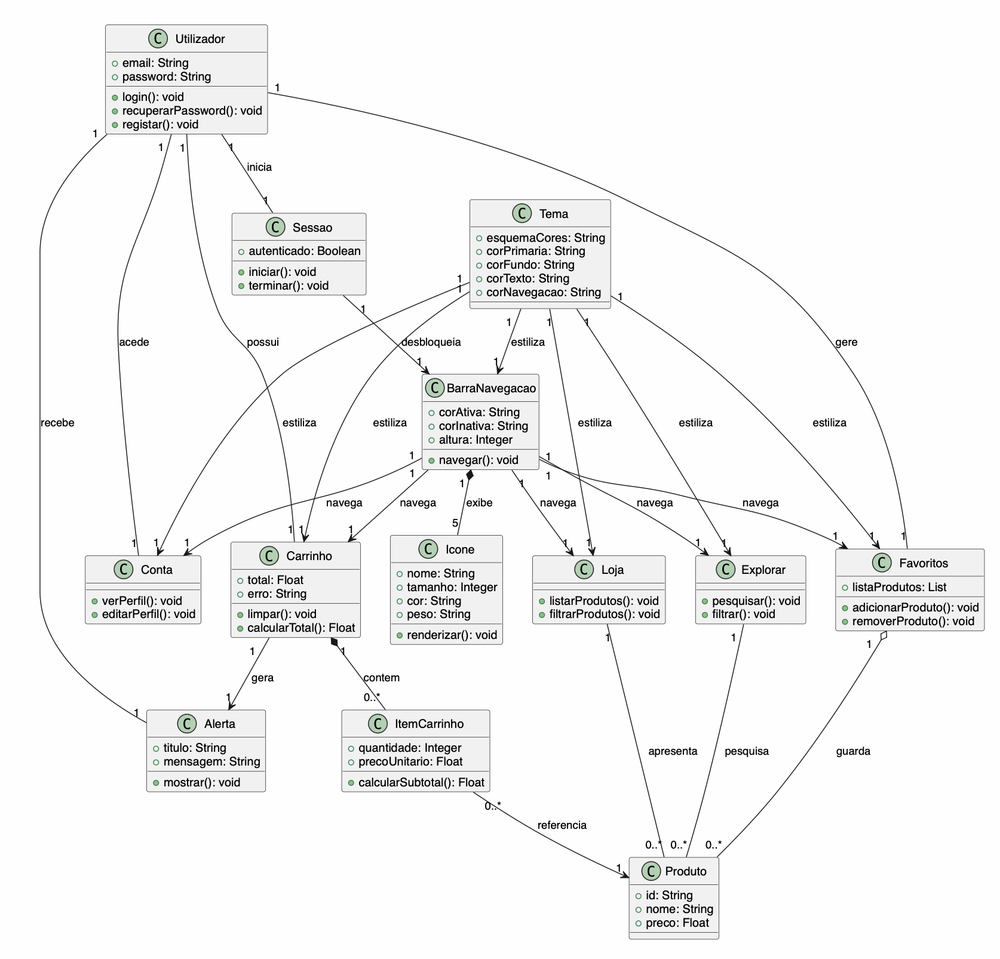
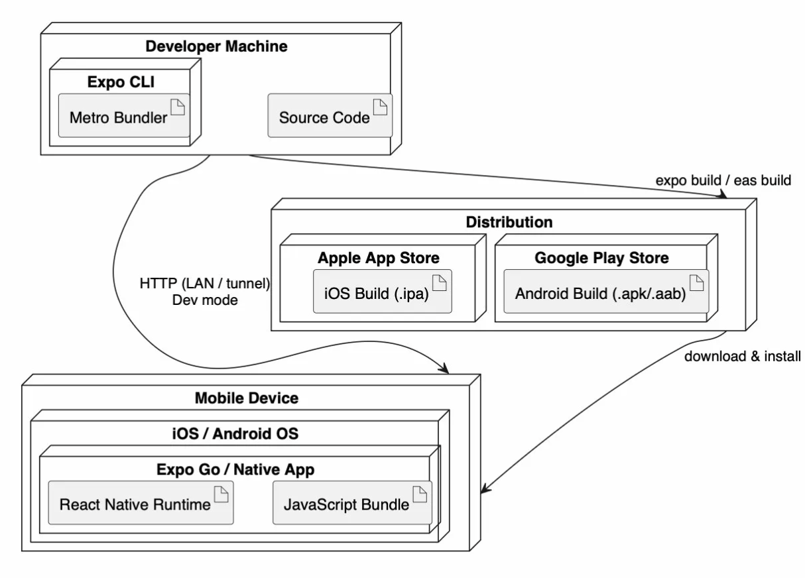
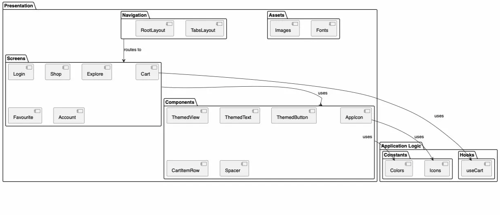

<!-- Template file for README.md for LEIC-ES-2025-26 -->

> [!NOTE] In this file, you will find the structure you should follow to document your mobile app in the README.md file for LEIC-ES-2025-26. It is a single file with guidelines. You can add more sections, but for assessment reasons and automation, please make sure to include all sections of this template. Your professors will clarify about specificities of your app.

# _[your product name]_ Development Report

Welcome to the documentation of _[your product name]_!

This Software Development Report, tailored for LEIC-ES-2025-26, provides comprehensive details about _[your product name]_, starting from an high-level vision and going into low-level implementation decisions.

It is organised by the following activities:

- [Business modeling](#Business-Modelling)
  - [Product Vision](#Product-Vision)
  - [Features and Assumptions](#Features-and-Assumptions)
- [Requirements](#Requirements)
  - [User stories](#User-stories)
  - [Domain model](#Domain-model)
  - [User interfaces](#User-interfaces)
- [Architecture and Design](#Architecture-And-Design)
  - [Logical architecture](#Logical-Architecture)
  - [Physical architecture](#Physical-Architecture)
  - [Functional prototype](#Functional-Prototype)
- [Project management](#Project-Management)
  - [Sprint 0](#Sprint-0)
  - [Sprint 1](#Sprint-1)
  - [Sprint 2](#Sprint-2)
  - [Sprint 3](#Sprint-3)
  - [Final Release](#Final-Release)

Contributions are expected to be made exclusively by the initial team, but we may open them to the community, after the course, in all areas and topics: requirements, technologies, development, experimentation, testing, etc.

Please contact us!

Thank you!

- Luís Miguel Branco Sampaio Costa | luismbsampaio@gmail.com
- José Dinis Rocha Melo Maçorano dos Santos | josedrmsantos1@gmail.com
- Afonso Sofia de Moura | up202403939@edu.fe.up.pt
- Daniel Filipe Cidade de Azeredo Lobo | up202306056@edu.fe.up.pt
- Pedro Cunha Gonçalves de Melo | up202406050@edu.fe.up.pt

---

## Business Modelling

O produto surge na necessidade do consumidor final saber onde o cesto de produtos que pretende comprar está mais barato, acompanhado promoções diárias cruzando dados de vários supermercados. A partir desta ideia inicial surgem outras features para a aplicação, por exemplo, recomendações de produtos com base no historico, dividir o cesto de compras em 2 supermercados, entre outras.

Business modeling in software development involves defining the product's vision, understanding market needs, aligning features with user expectations, and setting the groundwork for strategic planning and execution.

### Product Vision

E se houvesse uma aplicação que informasse o utilizador de onde o seu cesto de compras é mais barato, ajudando-o a poupar dinheiro? (nome da app) resolve este problema. Dado um cesto de produtos selecionados pelo utilizador, a aplicação analisa os preços nos principais supermercados portugueses e descobre onde o preço final do cesto é mais barato.

Além disso, se o utilizador tiver disponibilidade de ir a mais do que um supermercado e quiser poupar ainda mais, tem também a opção de receber a informação da melhor escolha de supermercado relativamente a cada produto selecionado.

A aplicação destaca-se no mercado devido à sua capacidade de atualização avançada, conseguindo obter os preços dos produtos em tempo real.

Esta aplicação surge na necessidade do consumidor final saber onde o cesto de produtos que pretende comprar é mais barato naquele exato momento, acompanhando as ofertas diárias de cada supermercado de modo que este consiga planear eficazmente as suas compras.

Partindo da ideia inicial, surgem outras funcionalidades potencialmente interessantes, tais como, por exemplo, recomendações de produtos com base no histórico, partilha do cesto de compras entre diversos utilizadores, entre outras.

<!--
Start by defining a clear and concise product vision for your app, to help members of the team, contributors, and users into focusing their often disparate views into a concise, visual, and short textual form.

The vision should provide a "high concept" of the product for marketers, developers, and managers.

A product vision describes the essential of the product and sets the direction to where a product is headed, and what the product will deliver in the future.

**We favor a catchy and concise statement, ideally one sentence.**

We suggest you use the product vision template described in the following link:
* [How To Create A Convincing Product Vision To Guide Your Team, by uxstudioteam.com](https://uxstudioteam.com/ux-blog/product-vision/)

To learn more about how to write a good product vision, please read:
* [Vision, by scrumbook.org](http://scrumbook.org/value-stream/vision.html)
* [Product Management: Product Vision, by ProductPlan](https://www.productplan.com/glossary/product-vision/)
* [20 Inspiring Vision Statement Examples (2019 Updated), by lifehack.org](https://www.lifehack.org/articles/work/20-sample-vision-statement-for-the-new-startup.html)
-->

### Features and Assumptions

- Feature principal - dado um cesto de produtos, a app dá output ao supermercado/loja onde o preço final é mais barato (já com as promoções)
- Feature secundária - Utilizador tem liberdade de querer comprar o cesto de compras apenas num supermercado ou em mais que um, conseguindo preços ainda mais baixos
- Recomendações - com base no histório de compras, recomendar certos produtos
- Filtrar a pesquisa por um conjunto de lojas - Utilizador tem liberdade de filtrar em que supermecados a query vai ser feita
- símbolo pegada de carbono - Se o produto tiver pouca pegada de carbono e for produzido de forma favorável ao ambiente terá um símbolo que o indicará
- Perfil - Cada utilizador terá um perfil próprio com as suas informações pessoais.
- Carrinho partilhado - Um carrinho que pode ser partilhado por vários utilizadores.
- Modo offline - Caso o utilizador não tenha acesso à internet, poderá abrir a aplicação e ver o que tem no carrinho sabendo assim o que precisa comprar.
- Definições - um menu onde tenha algumas definições da própria aplicação, notificações entre outras.
- símbolo nutricional - Indicador da qualidade nutricinal de cada produto.
- Horário - horário da loja onde se vai fazer compras.

<!--
Indicate an  initial/tentative list of high-level features - high-level capabilities or desired services of the system that are necessary to deliver benefits to the users.
 - Feature XPTO - a few words to briefly describe the feature
 - Feature ABCD - ...
...

Optionally, indicate an initial/tentative list of assumptions that you are doing about the app and dependencies of the app to other systems.
-->

## Requirements

### User Stories

TODO: add concise user stories

<!--
In this section you should describe all kinds of requirements for your module: functional and non-functional requirements.

For LEIC-ES-2025-26, the requirements will be gathered and documented as user stories.

Please add in this section a concise summary of all the user stories (not each user story!).

**User stories as GitHub Project Items**
The user stories themselves should be created and described as items in your GitHub Project with the label "user story".

A user story is a description of a desired functionality told from the perspective of the user or customer. A starting template for the description of a user story is *As a < user role >, I want < goal > so that < reason >.*

Name the item with either the full user story or a shorter name (recommended). In the “comments” field, add relevant notes, mockup images, and acceptance test scenarios, linking to the acceptance tests when available, and finally estimate value and effort.

**INVEST in good user stories**.
You may add more details after, but the shorter and complete, the better. In order to decide if the user story is good, please follow the [INVEST guidelines](https://xp123.com/articles/invest-in-good-stories-and-smart-tasks/).

**User interface mockups**.
After the user story text, you should add a draft of the corresponding user interfaces, a simple mockup or draft, if applicable.

**Acceptance tests**.
For each user story you should write also the acceptance tests (textually in [Gherkin](https://cucumber.io/docs/gherkin/reference/)), i.e., a description of scenarios (situations) that will help to confirm that the system satisfies the requirements addressed by the user story.

**Value and effort**.
At the end, it is good to add a rough indication of the value of the user story to the customers (e.g. [MoSCoW](https://en.wikipedia.org/wiki/MoSCoW_method) method) and the team should add an estimation of the effort to implement it using points in a kind-of-a Fibonnacci scale (1,2,3,5,8,13,20,40, no idea).

-->

### Domain model

  

O modelo de domínio é composto por 13 classes que representam os conceitos centrais do sistema. A entidade principal é o Utilizador, que possui um Carrinho com Produtos, uma lista de Favoritos, uma Conta e recebe Alertas do sistema. A navegação é gerida pela BarraNavegacao, composta por 5 Icones, e o aspeto visual é definido pelo Tema global da aplicação.

Para mais detalhes: [Domain Model PDF](docs/uml/domain/domain_model.pdf)

## Architecture and Design

A arquitetura da aplicação segue uma organização em camadas, separando a interface do utilizador da lógica de negócio. A camada de apresentação é composta por ecrãs e componentes reutilizáveis, enquanto a lógica da aplicação é gerida por hooks e constantes partilhadas. Esta separação facilita a manutenção e evolução do código ao longo do projeto.

### Logical architecture

  

A arquitetura lógica organiza o sistema em duas camadas principais: Presentation (Navigation, Screens, Components e Assets) e Application Logic (Hooks e Constants). A navegação encaminha para os ecrãs, os ecrãs utilizam os componentes, e tanto os componentes como os ecrãs dependem das constantes e hooks para lógica e estilo.

Para mais detalhes: [Architecture PDF](docs/uml/architecture/architecture.pdf)

### Physical architecture

  

A aplicação é frontend-only, sem backend próprio. Em desenvolvimento, o Expo CLI na Developer Machine serve o bundle via HTTP para o Mobile Device. Em produção, a app é compilada e distribuída através da Apple App Store (iOS) e Google Play Store (Android). A tecnologia escolhida foi React Native com Expo, permitindo desenvolver para iOS e Android com uma única base de código.

Para mais detalhes: [Architecture PDF](docs/uml/architecture/architecture.pdf)

### Functional prototype

<!--
To help on validating all the architectural, design and technological decisions made, we usually implement a functional prototype, a thin vertical slice of the system integrating as much technologies as we can.

In this subsection please describe which feature, or part of it, you have implemented, and how, together with a snapshot of the user interface, if applicable.

At this phase, instead of a complete user story, you can simply implement a small part of a feature that demonstrates thay you can use the technology, for example, show a screen with the app credits (name and authors).
-->

## Project management

<!--
Software project management is the art and science of planning and leading software projects, in which they are planned, implemented, monitored and controlled.

In the context of ESOF, we recommend each team to adopt a set of project management practices and tools capable of registering tasks, assigning tasks to team members, adding estimations to tasks, monitor tasks progress, and therefore being able to track their projects.

Common practices of managing agile software development with Scrum are: backlog management, release management, estimation, Sprint planning, Sprint development, acceptance tests, and Sprint retrospectives.

You can find below information and references related with the project management:

* Backlog management: Product backlog and Sprint backlog in a [Github Projects board](https://github.com/orgs/FEUP-LEIC-ES-2023-24/projects/64);
* Release management: [v0](#), v1, v2, v3, ...;
* Sprint planning and retrospectives:
  * plans: screenshots of Github Projects board at begin and end of each Sprint;
  * retrospectives: meeting notes in a document in the repository, addressing the following questions:
    * Did well: things we did well and should continue;
    * Do differently: things we should do differently and how;
    * Puzzles: things we don’t know yet if they are right or wrong;
    * list of a few improvements to implement next Sprint;

-->

### Sprint 0

### Sprint 1

### Sprint 2

### Sprint 3

### Sprint 4

### Final Release
